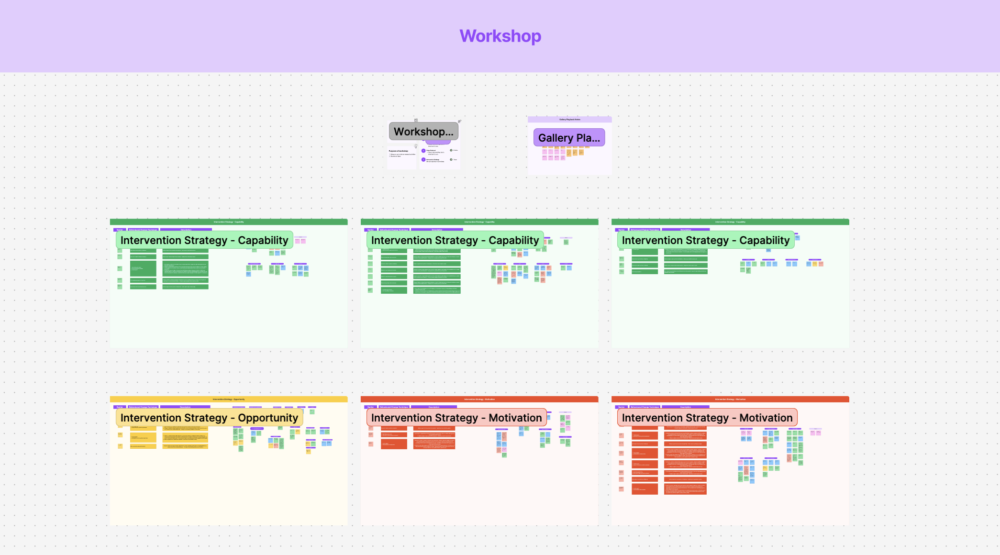
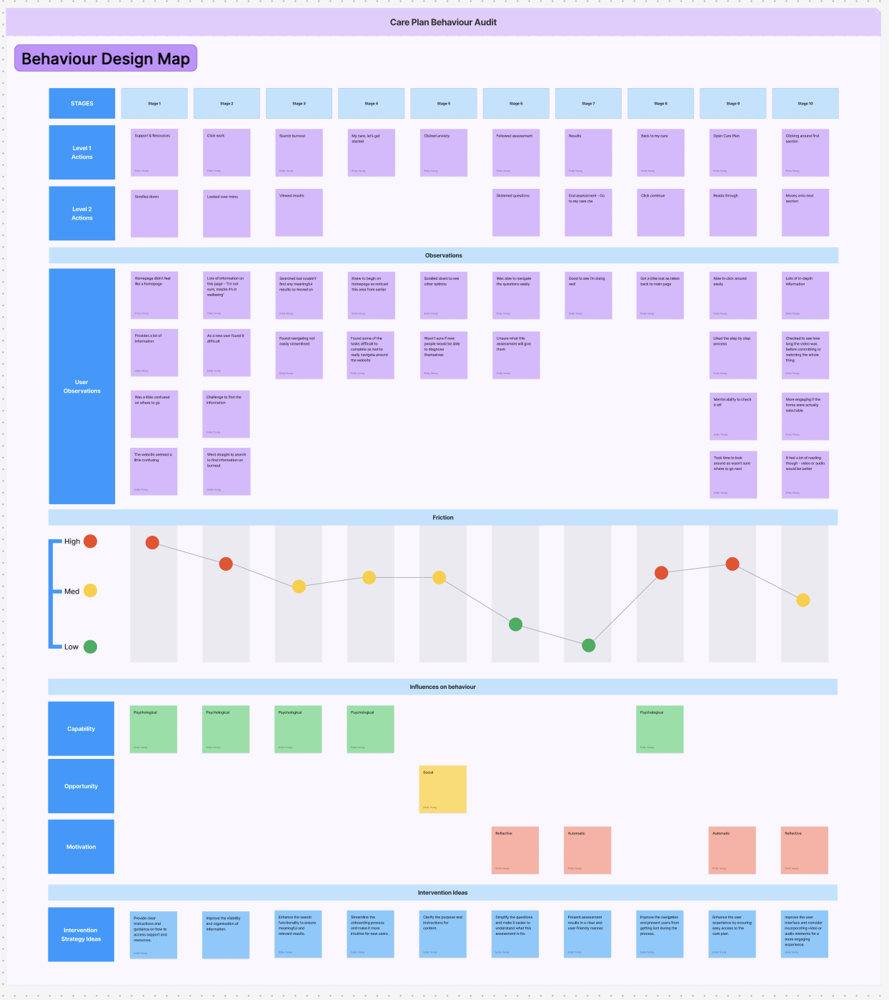

## The challenge
The product gave members structured care plans: guided programs of articles, exercises and tools to work through between (or instead of) therapy sessions. New members were signing up, but many didn’t finish care plan onboarding, and even fewer came back to their plan and tools afterwards.
The content team was about to invest in new care programs and wanted to know where to focus first. At the time, most people assumed the fix was more or better content. My job was to find out what was actually stopping people, before the roadmap committed to an answer.

## Activities conducted
* Discovery research: framed the problem with the content team and turned a broad request into a measurable target behaviour.
* Secondary research: reviewed existing member survey responses and back-end usage data to see where engagement dropped off.
* Semi-structured user interviews (18): explored motivations, triggers, frequency of use, what success looks like and pain points.
* Observational sessions (12): watched new members find, start and work through a care plan in the live product.
* Mixed-methods triangulation: combined qualitative evidence with survey and usage data to check the patterns held up.
* Behavioural diagnosis (COM-B): used the Behaviour Change Wheel to identify which capability, opportunity and motivation barriers were blocking the target behaviour.
* Behaviour design mapping: mapped a 10-stage journey with actions, observations, friction scores, COM-B influences and intervention ideas.
* Affinity synthesis: clustered interview and observation data into themes and sub-findings.
* Landscape review: listed the 25+ other wellbeing and health apps participants already used, to understand what they compared us against.
* Prioritisation workshop: worked with stakeholders to turn findings into techniques and score each recommendation by how easy it would be to build.
* Research operations: wrote the research plan, screener, discussion guide and a shared data-capture board.

## Framing the problem: from “engagement” to a target behaviour
A goal like “improve engagement” can’t be diagnosed. So, before writing a single interview question, I worked with the content team to define one specific behaviour using the COM-B model. That framing became the brief for every later decision, from who we recruited to how we scored friction.

> Target behaviour definition
> Challenge: Members aren’t using care plans for self-directed learning and struggle to see their value.
> Actor: New members of the platform.
> Target behaviour: Complete care plan onboarding, and return more often to the care plan and its tools.
> Outcome: Better self-directed learning and higher retention of new members.

### Research goals
* Understand members’ current pain points, frustrations and barriers with care plans.
* Find out what motivates or triggers people to engage with self-guided mental health support, and what keeps them coming back.
* Give the content team evidence for prioritising and designing future care programs.

## Approach: why these methods
Interviews + observation, not interviews alone. People are poor narrators of their own app habits, especially in mental health, where there’s a pull to give the “right” answer. Interviews told us why people sought support and what they valued. Observation showed us what actually happened when someone opened a care plan. Together they showed both what people said and what they actually did.

Secondary data to keep us honest. Survey and back-end usage data had already shown where drop-off happened. Primary research was there to explain why. Pairing them meant qualitative patterns could be checked against real behaviour, not just a handful of vivid stories.

COM-B as the analytical backbone. I brought the Behaviour Change Wheel in deliberately. It gave a cross-functional team a shared, evidence-based language for why behaviour wasn’t happening. That moved the conversation away from intuition and towards interventions linked to a specific barrier.

## Recruitment
I screened for people across Canada and the USA who had recently used wellbeing or healthcare services, so that their experience was fresh rather than remembered. Participants used a mix of our product and other digital mental health apps. That let us see our care plans against the habits people had already formed elsewhere.
We reached 30 participants in total: 18 took part in interviews and 12 in observed sessions. Splitting the sample this way gave us depth on motivations from the interviews, and enough observed sessions to score friction stage by stage.

## Analysis and synthesis
Synthesis ran in two passes, one focused on behaviour and one on themes, so we could answer two different questions: where does the journey break, and what do people actually need?

### Pass 1: Behaviour design mapping
Using the observation data, I broke the target behaviour into 10 stages, from landing on the home page to working through the first section of a care plan. For each stage, the map captured:
* Level 1 and level 2 actions: what the participant actually did.
* User observations, tagged directly from session notes and quotes.
* A friction score (high, medium or low), plotted as a line across the journey.
* The COM-B influence behind it: psychological capability, social opportunity, or reflective or automatic motivation.
* An intervention idea that targeted that specific barrier.
The friction line changed how stakeholders saw the problem. Friction was highest at the very start (a home page that “didn’t feel like a home page” and too much information up front) and again when people got lost going back into their plan. The assessment and results steps scored low. Most of the friction was about finding the way in and getting back, not about the care plan content itself.

<figure class="figure">
	
    <figcaption>Figjam view of the workshop</figcaption>
</figure>

### Pass 2: Affinity synthesis into themes
I then clustered interview data, observation notes and supporting quotes into an affinity map. Three themes and 17 sub-findings came out of it. We tested each theme against the survey and usage data before committing to it.
* Continuous care: people wanted therapy and self-guided resources joined up, plus more check-ins and visible progress “without guilt”.
* Personalisation and customisation: content felt one-size-fits-all; assessments were completed once and never revisited.
* Content utilisation: short formats, audio, relatable real stories, findability and neurodivergent-friendly design.

## What changed in our thinking
Going in, we expected that care plans needed more content. Synthesis challenged that. Many participants said they research, read and try things on their own before seeking therapy, especially when the issue isn’t urgent. For them, self-guided content was a first step towards care, not a replacement for it. Yet our care plans were treated as separate from therapy, and providers often couldn’t see or recommend them.
That changed the question from “what content should we add?” to “how do we fit care plans into someone’s path into care, and personalise them so they feel relevant?”

> In participants’ words
> “Therapists added initial comfort and then resources after. Important to have both the self-guided tools and therapy.”
> “It’s difficult to find what I need as I’m not sure exactly what I’m looking for and there is a lot of content here.”
> “Being able to customise the experience and ability to skip or deselect topics that are not applicable or have already read about before.”

<figure class="figure">
	
    <figcaption>High level view of the behaviour design map deliverable from the full care plan behaviour audit</figcaption>
</figure>

##  From insights to action
I didn’t want the findings to sit in a deck, so I ran a workshop with the content, design and product partners. For each theme, we turned findings into techniques (for example Goals, Check-ins, Provider integration, Curated content and Community). We then scored every recommendation as easy, difficult or hard to implement.
The result was 42 recommendations across 15 technique areas. The team could pick quick wins straight away, such as explaining what a care plan is and why to use it, offering audio formats, and adding a timed check-in after onboarding. Larger bets, such as provider access to care plans, a searchable resource library and multiple care plans per member, went onto the roadmap discussion.

## Impact
* Changed the problem the team was solving: the work moved the focus from producing more content to fit, personalisation and continuity of care.
Gave the content roadmap prioritised inputs: 42 recommendations, each tied to a behavioural barrier and an ease-of-implementation score.
* Built a shared language: COM-B and the behaviour map gave design, content and product a common way to discuss why members weren’t returning.
* Documented the study so it can be repeated: the research plan, screener, discussion guide and data-capture board mean the study can be rerun or extended.

## Reflections
* I’d bring providers in earlier. Several of the strongest recommendations depend on therapists using care plans, yet the sample was members only. A small round of provider interviews would have made those recommendations harder to dismiss.
* I’d size the themes with a quick follow-up survey. The qualitative evidence was strong, but a short survey would have shown how widespread each need was and made prioritisation easier to defend.
* I’d keep the behaviour map. The friction line made the problem visible at a glance. Defining the target behaviour with stakeholders up front is something I’d do on every behaviour-focused study.
* I’d make the report leaner. The full report was detailed. Next time I’d lead with a one-page summary and move the depth into an appendix.
