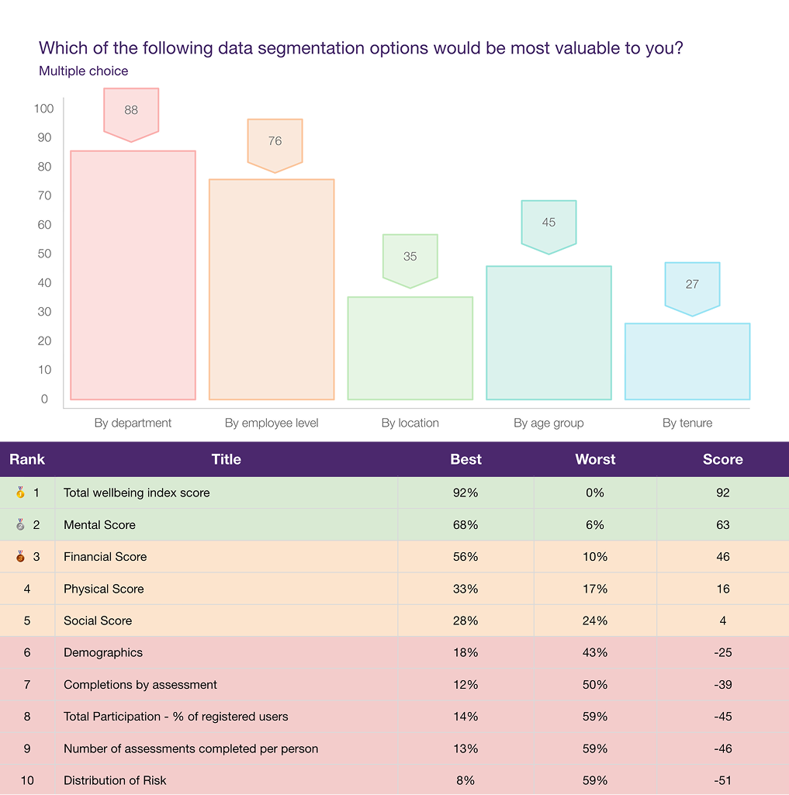

## The challenge
The organisation provides an Employee Assistance Program (EAP) and digital wellbeing platform to employers. Alongside the employee-facing app, HR and wellbeing leaders use a reporting portal to see how their workforce is engaging with the programs they pay for. That view is how employers judge whether the program is working.

Over time, the portal's reporting had grown to cover five areas: guided wellbeing programs, wellbeing indicator scores, health assessments, challenges, and a rewards and tiers system. Each module carried several metrics, and each metric had a reason to exist. As the design team prepared to rework how this data was presented, the core question was simple: what should an HR leader see first?

Without evidence, the answer would default to whoever argued most persuasively, or to showing everything at equal weight. This study was designed to put a rank order on every live metric, so that layout decisions would rest on what users valued rather than on internal opinion.

## Activities conducted
* Discovery research: audited every wellbeing metric already reported to clients across the book of business
* Survey design: built MaxDiff (best–worst scaling) choice tasks for five reporting modules
* Participant recruitment: employer clients across global regions, plus internal customer success managers
* Quantitative analysis: best–worst preference scoring and ranking within each module
* Cross-module synthesis: looked for patterns across all 27 metrics to explain why some metrics won and others lost
* Research readout and recommendations: findings report and reporting-hierarchy rules for the design team

## Research question and goals
Which wellbeing metrics do HR leaders value most, and least, when judging their program, and what should the reporting portal lead with?
1.  Rank every live metric within its reporting module by relative importance
2.  Identify what to demote, not just what to keep
3.  Turn the ranking into a hierarchy the design team could build from directly
I defined success up front as a defensible rank order for every module, an explicit deprioritise list, and recommendations specific enough to apply to a layout without another round of debate.

## My approach

### 1. Discovery: start from what already exists
Rather than asking users to imagine an ideal dashboard, I started with a metric audit across the book of business, listing every wellbeing metric already reported to clients. That gave me 27 real metrics. Grounding the study in metrics that already existed meant every result would map to something on a real screen, and the team could act on it straight away.

### 2. Why MaxDiff instead of a rating scale
When people rate reporting metrics on a scale, almost everything comes back as important, which gives a design team nothing to prioritise. MaxDiff forces a trade-off: in each task, participants choose the single most and single least important item from a set. Repeated across the set, this produces a true relative ranking and shows what people actively don't want, not just what they like.
I grouped the 27 metrics into their five reporting modules so that every choice compared like with like (a program metric against other program metrics), with four to ten metrics per module. Each module's question was worded to match its content, for example "most and least valuable wellbeing indicators" and "most and least crucial assessment data points".

### 3. Recruitment: the people who read the reports, and the people who explain them
I recruited 47 participants. Most (72%) were employer clients, the HR and wellbeing leaders who use the portal, drawn from a range of key regions so the result would not reflect one market's reporting habits. The other 28% were customer success managers, who sit between clients and the product and hear reporting questions first-hand. Including them gave a second view of what clients ask for when they review their program. The survey was in field for two weeks.

### 4. Analysis: scoring, then reading beneath the score
For each metric I calculated a preference score: the percentage who chose it as most important minus the percentage who chose it as least important, giving a range from −100 to +100. I then ranked metrics within each module.
I deliberately kept the raw best and worst percentages next to every score, because the score alone can hide what is going on. Total wellbeing index score was picked as most important by 92% of participants and as least important by nobody, which is near-unanimous agreement. By contrast, Total programs started scored only +8, but that came from 34% best and 26% worst. It wasn't a metric people ignored; it was one that divided them. That distinction mattered when deciding what to demote and what to keep one click away.

### 5. Synthesis: from five rankings to one pattern
At first, the results read as five separate answers to five separate questions. The useful insight came from stepping back and lining the modules up side by side, comparing what the winners had in common and what the losers had in common, regardless of module.
Four patterns held across the modules:
* Reach over intensity. Totals such as users who started a program (+70) and challenges joined (+59) consistently won. Every per-user average in the study finished in the bottom two of its list, including average points per user (−91).
* One headline score, then its drivers. The overall wellbeing index (+92) led, followed by the mental (+63) and financial (+46) scores that explain it. Detailed breakdowns such as distribution of risk (−51) fell to the bottom.
* Show it, don't tabulate it. Charts of all assessment results (+76, never chosen as least) beat the summary table (+30).
* Meaning over volume. Metrics without a clear "so what" sank, such as total steps tracked (−88) and readiness-to-change charts (−85).
Because MaxDiff measures what people prefer, not why, I kept the scores and my interpretation of the reasons clearly separate in the report. The "why" was presented as reasoned interpretation the team could test, not as fact.

## Outputs and sharing
I delivered a research report to the Employer Experience Design team, structured so a designer could act on it module by module. For each module it showed the top three metrics alongside the reporting component each one maps to, so the team could see the finding in the context of the screen they would be changing. Full results tables and my interpretation of the reasons followed.
The report closed with three rules for the reporting hierarchy, each backed by a score:
1.  Lead with reach: headline totals first; move per-user averages into drill-down views
2.  One score, then its drivers: open with the overall wellbeing score, then mental and financial
3.  Show it, don't tabulate it: chart assessment results by default; keep the table as a secondary view
It also included an explicit list of metrics to deprioritise: per-user averages, steps tracked, readiness-to-change charts and distribution of risk. My recommendation was to keep detailed data available for those who want it, but not in prime position.

<figure class="figure">
	
    <figcaption>A snapshot of the data and results from the study</figcaption>
</figure>

## Outcome
* Replaced opinion with a rank order. The design team had an evidence-based answer to "what goes first?" for every reporting module, drawn from the people who actually use the reports.
* Gave the team permission to cut. A clear deprioritise list meant low-value metrics could move out of prime space without a debate about each one.
* Created a reusable rule set. "Totals over averages, one headline score, charts over tables" applies to any new module added to the portal, not just the five we tested.

## Reflections
### What I would do differently
* Pair the survey with short follow-up interviews. MaxDiff told us what HR leaders valued; a handful of 30-minute conversations would have turned my interpretation of why into evidence.
* Segment the results. With clients and customer success managers in the same sample, I would report the two groups separately to check whether internal teams' view of client needs matches clients' own.
### What I would keep
* Forcing the trade-off. Conversations about reporting drift towards "include everything". MaxDiff gave the team a shared, numeric language for what to demote, which a rating scale would not have done.
* Starting from real metrics. Auditing what already existed kept the study tightly scoped and made every finding immediately actionable.
### What this project taught me
The most valuable output of a prioritisation study is often the list of things to remove. Knowing that four per-user averages consistently finished last was as useful to the design team as knowing what came first.
