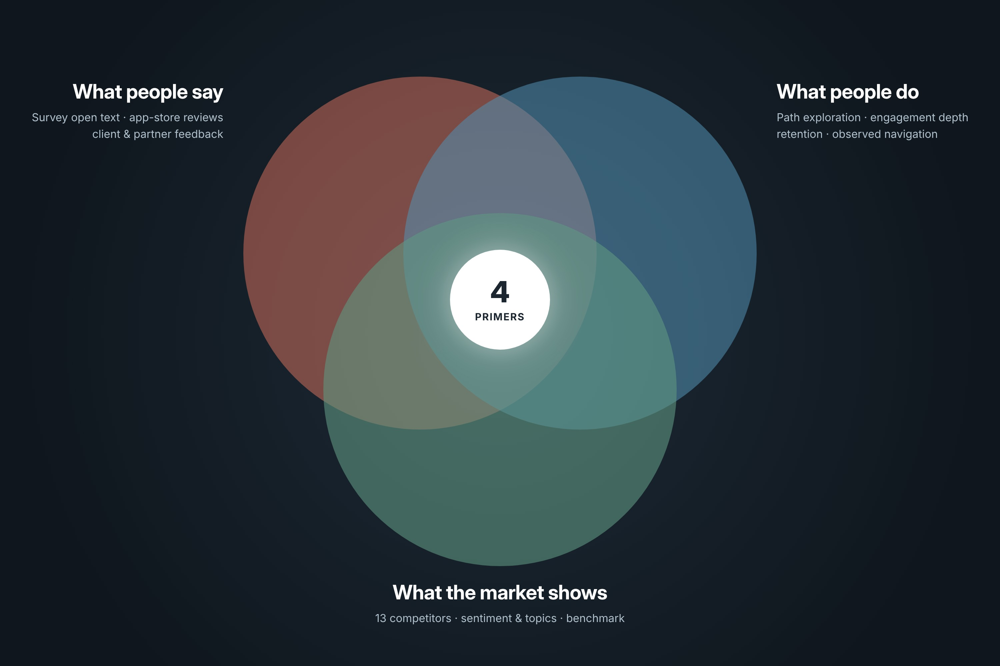
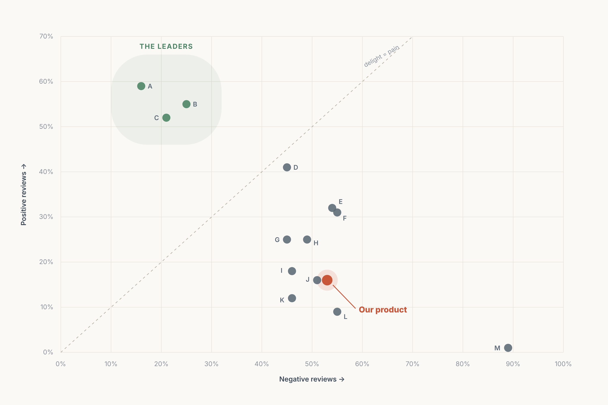
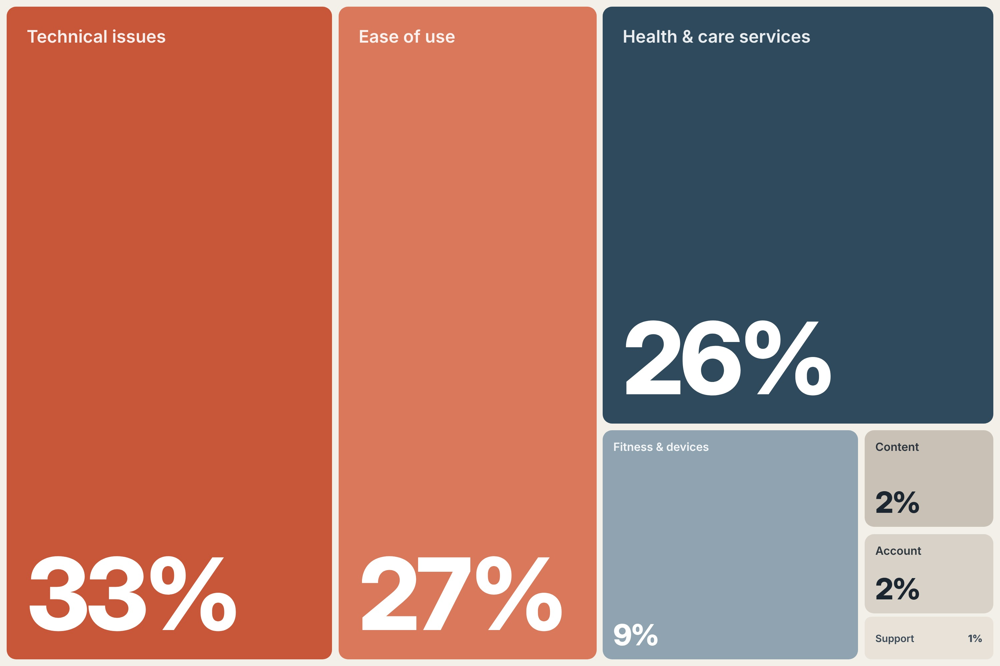
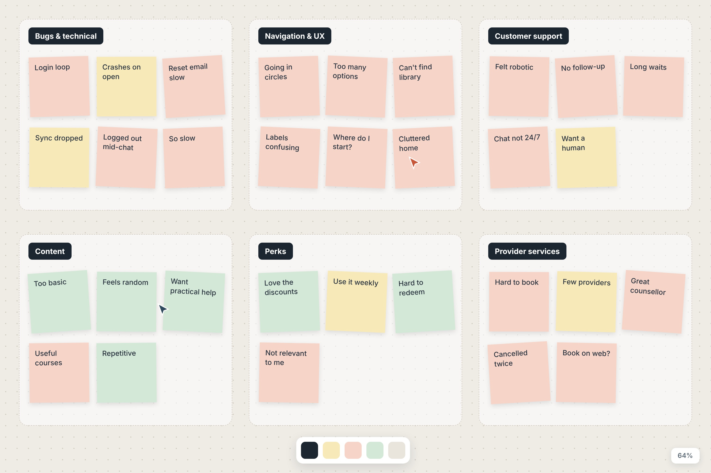

## The challenge
The product is an employer-sponsored health and wellbeing app. Employers buy it for their people, often through channel partners, and members use it to reach counselling and care, find wellbeing content and programmes, and redeem perks. That makes it a three-sided experience: members, the employer clients who pay for it, and the partners who sell and configure it, each with different ideas of success.
It also makes the stakes unusually high. Many members open the app when they are stressed or struggling. A failed login or a confusing menu isn’t just friction, it can be the moment someone gives up on asking for help. 

## Activities conducted
* Discovery research	Framed the work as strategic discovery: what is really holding the member experience back, and where should we invest first?
* Mixed-methods research	Combined qualitative feedback with survey scores, benchmark data and behavioural analytics so every theme had both a ‘why’ and a ‘how much’.
* Competitive analysis	Benchmarked our app against 13 competitors using a year of public app-store reviews, producing a sentiment and topic profile for each.
* Survey analysis	Analysed an always-on in-product survey - usability (SUS) and satisfaction scores month by month, plus open-text responses.
* UX benchmarking	Drew on a quarterly benchmark of task success and attitudinal measures (ease of use, trust, appearance, loyalty) against peers.
* Behavioural analytics	Used path exploration, engagement depth and retention analysis to test whether behaviour backed up what people said.
* Qualitative coding & thematic analysis	Built and applied a codebook (7 topics for the market, 10 for our product), classified sentiment, and clustered themes.
* Usability observation	Synthesised observed navigation behaviour from studies run across the team.
* Desk research	Folded in win/loss insight, client and partner feedback and CSAT as qualitative context.
* Triangulation & synthesis	Only progressed a theme to a recommendation when feedback, behaviour and market evidence agreed.
* Stakeholder read-out	Presented the primers and closed with a facilitated discussion on the barriers to acting on them.

## Where the project came from
Most of the experience problems weren’t new. The design team had been raising them for some time, and they were becoming more visible in feedback. But the evidence was fragmented, app-store reviews, an in-product survey, a quarterly benchmark, analytics, win/loss notes and client feedback all sat in different places, owned by different teams. Each problem could be dismissed as an anecdote, and none of it was framed in the terms that win roadmap time.
The answer was a different kind of deliverable: rather than another study, a strategic synthesis that would make a year of insight accessible, credible and timely enough to shape direction-setting conversations so decisions were anchored in user evidence, not just business or technical priorities.

### My role
I led the work end to end as the sole researcher, sitting within the experience design team: framing, data gathering, coding, analysis, synthesis, the report and the read-out. I drew on input from customer success managers who hear clients’ reactions first-hand and on usability studies run by colleagues.

### Research goals
1.	Consolidate. Bring a year of evidence from across the organisation into one shared, trustworthy view of the member experience.
2.	Benchmark. Understand where we stood against 13 competitors, and what ‘good’ looks like in this market.
3.	Prioritise. Translate the findings into a small number of actionable recommendations tied to business outcomes and ready for planning.

### How I defined success
* Every recommendation corroborated by at least two independent evidence types, not a single loud source.
* A short list of priorities, few enough to act on, each linked to a business lever leadership already tracked.
* A format teams could lift straight into planning, with transparent limitations and links to the underlying data.

## Approach

<figure class="figure">
	
    <figcaption>A theme became a primer only where what people say, what they do and what the market shows overlapped</figcaption>
</figure>

### Why mixed methods
Each source on its own had a blind spot. App-store reviews skew towards the extremes. Survey scores tell you how satisfied people are, but not why. Analytics show where people go and drop off, but not what they were trying to do. Combining them let each source check the others and made the conclusions much harder to dismiss.
I deliberately chose not to run new primary research at this stage. The organisation already held a year of signal; the gap was synthesis, not data. That kept the work fast and meant every finding could be traced back to evidence teams already owned.

### Timeline

1. *Frame* Defined the purpose: turn what the organisation already knew into prioritised, investable direction.
2. *Gather* Pulled 12 months of evidence from six streams into one working set; documented sources and limitations up front.
3. *Code the market*	Built a 7-topic framework and coded a year of reviews for 14 apps by topic and sentiment.
4. *Code our product* Extended to a 10-topic codebook for our own feedback; analysed survey trends and benchmark scores.
5. *Trace behaviour*	Path exploration, engagement depth and retention analysis to corroborate or challenge the themes.
6. *Synthesise* Theme lenses, cross-source triangulation, and prioritisation into four primers mapped to business levers.
7. *Share* Strategic report and read-out with a facilitated discussion; evidence pack shared for self-serve use.

## Benchmarking against the market
I collected a year of public Google Play and App Store reviews for our app and 13 competitors spanning employee assistance, digital mental health and virtual care. I created a seven-topic framework (account management, customer support, ease of use, fitness and device compatibility, health and care services, content, technical issues), wrote a definition for each so coding stayed consistent, then coded every review by topic and sentiment.
For each app I produced a one-page profile, sentiment ratio, top two topics, a summary and representative quotes so stakeholders could quickly see what each competitor does well and badly.

<figure class="figure">
	
    <figcaption>Positive vs negative review share for 14 apps (competitors anonymised)</figcaption>
</figure>

Two things stood out. First, our app sat in the lower third on positive sentiment, valued for breadth of content and holistic wellbeing, but held back by reliability and usability. Second, across the whole market, six in ten topic mentions were about whether the app works and whether it’s easy to use. The leaders weren’t winning on features; they were winning on reliability, intuitive navigation and fast, human access to care.

<figure class="figure">
	
    <figcaption>Share of topic mentions across all 14 apps</figcaption>
</figure>

## Analysis and synthesis
This is where most of the work and most of the judgement happened.

### 1 CODING
For our own product I extended the framework into a ten-topic codebook (bugs, content, customer support, features and functionality, fitness and devices, provider services, overall experience, perks, UI and UX). I coded open-text feedback from the in-product survey, the benchmark study and app-store reviews in a qualitative analysis tool, and built a sentiment-and-topic calculator so anyone could check the numbers behind each chart. Win/loss notes, client and partner feedback and CSAT were read alongside as context rather than counted.

### 2 THEME LENSES
Rather than only clustering pain points, I sorted themes through three lenses: user needs and expectations, positive highlights, and critical pain points. Keeping what works in view mattered, it stopped the report reading as a list of complaints and showed teams what to protect while fixing the rest.

<figure class="figure">
	
    <figcaption>Clustering coded feedback by topic and sentiment (recreated illustration; notes paraphrased)</figcaption>
</figure>

### 3 TRIANGULATION
I then tested each candidate theme against behaviour and the market. A theme only became a primer when the sources agreed:
* Navigation: complaints about going ‘in circles’ lined up with heavily branching journeys from the home screen, short sessions, and usage concentrated in a handful of areas.
* Reliability: login, crash and sync complaints lined up with a sharp drop in returning users after the first week and technical issues were the single biggest topic across the market.
* Support: members describing support as ‘cold’ contrasted sharply with the competitors praised for empathetic, connected digital-to-human care.

### 4 WHERE MY THINKING CHANGED
Going in, the content complaints read like a quality problem - ‘too basic’, ‘random articles’. Customer success managers told a different story: once they walked clients through what was actually available, perceptions flipped. That reframed the primer from ‘improve the content’ to ‘fix relevance and discoverability’ a very different brief for the team.
Analytics challenged a second assumption. The area with the deepest repeat engagement wasn’t health content at all, it was perks. Not everyone arrives with health in mind, so I recommended treating that area as a doorway into the rest of the experience rather than designing the information architecture around a single ‘health’ intent.

## What I delivered
The core output was four strategic primers, presented on a single executive-summary page and then in depth. Each pairs a validated user problem with the business lever it moves engagement, satisfaction and loyalty, efficiency and cost, or brand perception so it can compete for roadmap time on business terms.

### Designed to be used, not filed
I gave every primer the same five-part structure, user problem, what’s happening, opportunity, design principles and supporting data so teams could compare them side by side and lift sections directly into planning. The design-principles section mapped each problem to relevant cognitive biases and UX principles (for example progressive disclosure and choice overload for navigation, or error recovery and redundancy for reliability), giving designers a starting point rather than a finished solution.
The report also opened with a page connecting UX to the business levers, and closed with an appendix of research limitations, app-review bias, mobile-weighted analytics, subjectivity in coding and links to the codebook, coding output, calculator and raw data. Being upfront about limitations built more trust than overstating certainty would have.

### Sharing and activation
I ended the read-out on a question rather than a summary: what would stand in the way of acting on this? Turning the last slide into a facilitated discussion was designed to move the conversation from ‘is this true?’ to ‘what would it take?’ and to surface practical blockers while the evidence was fresh.
The report also named a tension that had been simmering between stakeholders, employer clients wanted the data that in-app assessments provide, while partners wanted fewer of them to protect engagement. I recommended bringing members into that conversation instead of resolving it on their behalf.

## Impact
* UX as a business lever. Long-known experience debt was reframed in the language of engagement, retention, cost and brand and backed by a market benchmark rather than internal opinion.
* A recurring practice. The primer format became an annual strategic research product. The following year’s edition fed directly into investment planning and a leadership showcase of the research function.
* Seeded the next study. The onboarding and login findings became a formal input to a follow-on first-time-use service design project.

## Reflections
* What I’d keep: triangulating before recommending. Requiring agreement across sources made the primers hard to dismiss, and it’s now how I approach any strategic synthesis.
* What I’d change: attach a measurable signal to every primer from day one, for example first-login success for reliability so progress could be tracked rather than just discussed. I built this into the next edition.
* What I’d add: a second coder for inter-rater checks to reduce subjectivity, and a small round of interviews to probe the ‘why’ behind the strongest review themes.
The biggest lesson: research rarely fails for lack of data. It fails when insight is scattered, unprioritised and framed in the wrong language. Sometimes the most valuable study is the one that makes everything you already know impossible to ignore.
