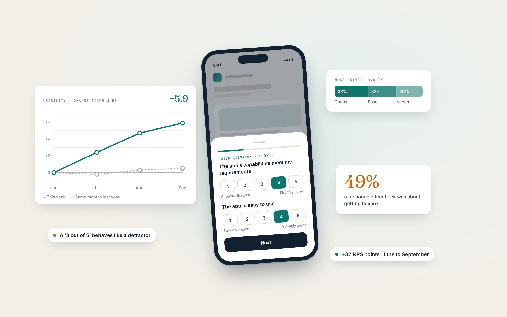
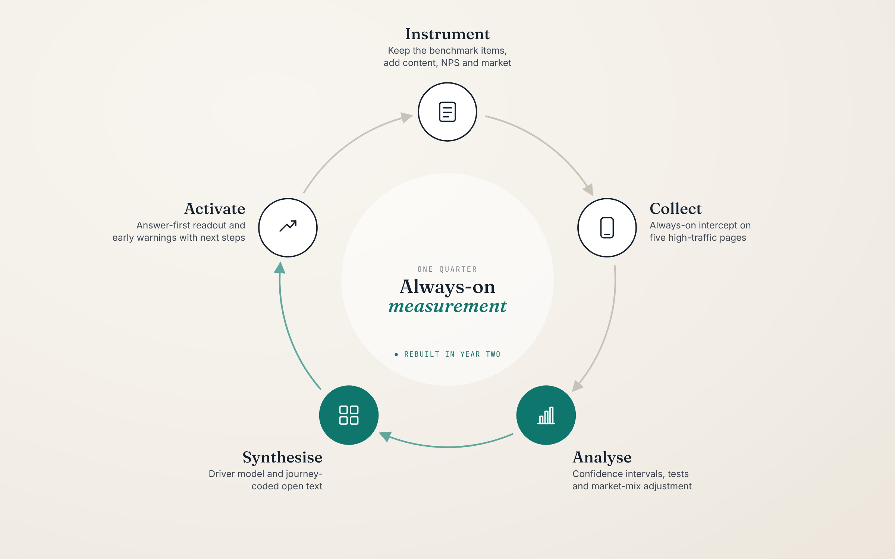
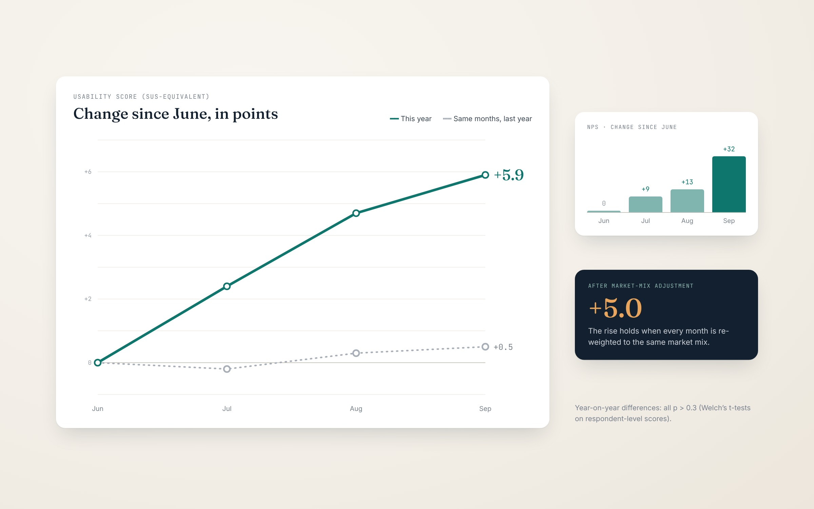
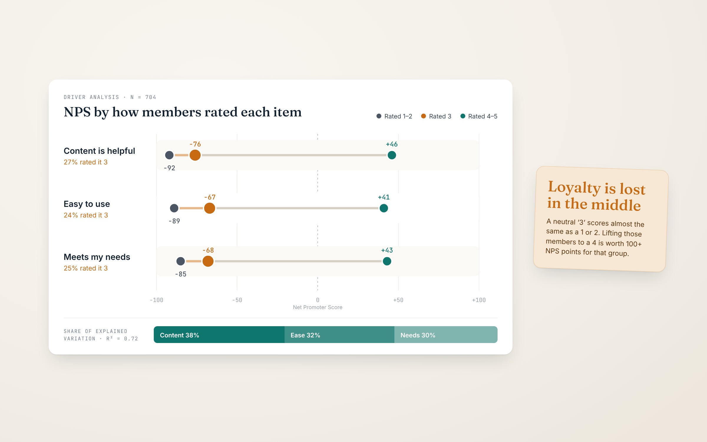

## The challenge
The product is a digital wellbeing platform that employers provide to their people. Members use it to find support services, book time with a counsellor, chat to someone, and read wellbeing content. It serves members across several international markets.

For the previous year I had run UX Measure, an always-on in-product survey that tracks perceived usability and satisfaction every quarter. That first year gave the team a reliable scorecard: we knew where the experience sat (around the industry average) and which broad complaints came up most.

## Activities conducted
* Survey design: evolved the instrument, keeping two benchmark items for continuity and adding content helpfulness, likelihood to recommend and market.
* In-product survey: always-on intercept on five high-traffic pages, run in short fieldwork windows across the quarter.
* Quantitative analysis and benchmarking: usability (UMUX-Lite converted to a SUS-equivalent), satisfaction, content helpfulness and Net Promoter Score, graded against an industry scale.
* Statistical testing: 95% confidence intervals and Welch’s t-tests on respondent-level scores, so the team knew which differences were real.
* Market-mix adjustment: re-weighted each month to a common market mix to check whether trends were real or just a change in who answered.
* Driver analysis: a relative-importance model of loyalty on the three experience items (R² = 0.72).
* Open-text coding: re-coded every written comment into nine journey themes, multi-coded.
* Mixed-methods synthesis: triangulated the scores, the driver model and what members wrote to find where the experience broke down.
* Longitudinal benchmarking: compared year on year and month by month, separating real movement from noise.
* Stakeholder readout and activation: an answer-first readout with early warnings, each paired with a concrete next step.

<figure class="figure">
	
    <figcaption>The in-product survey and the headline findings.</figcaption>
</figure>

## Where the project came from
In year two the question changed. Knowing the score was no longer enough: the team needed to know whether the experience was getting better, and where to invest to make it better.
The first cut of the data gave an uncomfortable answer: the quarter was level with the same quarter the year before. Usability, the two-item usability score and satisfaction had all dipped very slightly, and none of the differences were statistically significant. Reported at face value, the readout would have said “nothing changed”, and the team would have had nothing to act on.

There were also good reasons to distrust that headline. The survey had been paused for several months, fieldwork ran on fewer days than the year before, most of the quarter’s responses came from a single month, and we were now recording each member’s market for the first time, which showed the sample was far from evenly spread.

> A flat headline is a question, not an answer.

## Goals and success criteria

### Research goals
* Say honestly whether the experience improved: year on year, and within the quarter, with the uncertainty stated plainly.
* Explain what drives loyalty: which part of the experience moves members from detractors to promoters.
* Point the team to fixable moments: turn open-text feedback into specific points in the member journey.

### What success looked like
* A one-page answer that a product leader could act on without reading the rest of the deck.
* Every claim backed by a confidence interval or significance test, so nobody over-read a noisy month.
* Every theme mapped to a journey moment, and every early warning paired with a next step.

## Approach and methodology

The work ran as one quarterly cycle in five phases. I kept the collection method stable for comparability and put the new investment into analysis and synthesis, where the year-one readout had been thinnest.

<figure class="figure">
	
    <figcaption>The quarterly measurement cycle. The analysis and synthesis phases (teal) were rebuilt in year two</figcaption>
</figure>

### Why this method
An always-on intercept survey suited the job because the team needed a continuous, comparable signal across a large global member base, not a one-off deep dive. I used UMUX-Lite, a validated two-item usability measure, instead of the full ten-item System Usability Scale to keep the survey short enough not to annoy members mid-task. It converts to a SUS-equivalent score using a published regression, which let us benchmark against industry norms.

For year two I kept those two items exactly as they were so the trend line stayed intact, and added three things: a content helpfulness rating, likelihood to recommend (for a Net Promoter Score), and the member’s market. Each answered a question the year-one readout couldn’t: does the content help, are we earning loyalty, and is the picture the same everywhere?

### Who took part
The survey appeared on five high-traffic pages, from the homepage through to the pages members use to reach care. This placed it at the moments where usability matters most. In the quarter it collected over 1,100 responses (up from just under 1,000 the year before) and 98 written comments. Not everyone answered every item, so each measure had its own base, typically 700 to 800 members, and I reported that base next to every number.

### Sample questions
* “[Product]’s capabilities meet my requirements.” (1 to 5, agree to disagree)
* “[Product] is easy to use.” (1 to 5)
* “Overall, I am satisfied with [Product].” (1 to 5)
* “The content on this website is helpful.” (1 to 5, new in year two)
* “How likely are you to recommend [Product]?” (0 to 10, new in year two)
* “How could we improve?” (open text)

## Analysis and synthesis

This is where most of the work happened. Year one reported monthly averages and spread. In year two I rebuilt the analysis so it could explain why scores moved, not just where they sat.

### 1. Testing the flat headline
I started by refusing to accept the year-on-year comparison as the story. Running Welch’s t-tests on respondent-level scores confirmed that none of the differences were significant (all p > 0.3). So I broke the quarter into months, and a different picture appeared: the usability score climbed by almost six points from June to September, while the same months the year before had moved by less than one. Net Promoter Score rose by 32 points over the same period, and September was the first month on record with more promoters than detractors.

The quarter only looked flat because July supplied most of the responses (62%), and July was the lowest month. A single quarterly average had buried the momentum.

<figure class="figure">
	
    <figcaption>Change in usability score since June, against the same months last year, with the NPS change and the mix-adjusted result.</figcaption>
</figure>

### 2. Ruling out a sampling artefact
A rise like that could simply mean different people answered in different months. Because we now recorded each member’s market, I re-weighted every month to the same market mix. The rise held at five points, so it was a real change in experience, not a change in who answered.

The market cut also surfaced the biggest single opportunity. The largest market, about half of all responses, trailed another major market by 8.5 points and did not move during the quarter (p = 0.85) while the others rose. Because it carries so much weight, each point gained there lifts the overall score by about half a point.

### 3. Finding what drives loyalty
Next I modelled loyalty against the three experience items. Together they explained 72% of the variation in Net Promoter Score, with content helpfulness the largest driver (38%), ahead of ease of use (32%) and meeting needs (30%).

Splitting members by how they rated each item showed something the averages couldn’t: members who gave a neutral 3 out of 5 behaved almost exactly like members who gave a 1 or 2. Their NPS sat around −70. About a quarter of members gave each item a 3, so lifting them to a 4 is worth over 100 points of NPS for that group. That moved the conversation from “raise the average” to “win over the middle”.

<figure class="figure">
	
    <figcaption>Net Promoter Score by how members rated each item, and each item’s share of explained variation.</figcaption>
</figure>

### 4. Re-coding the open text against the journey
The year-one readout grouped comments into three broad buckets: positive, negative and new users. That was too broad to act on. This time I read all 98 comments, set aside the 25 that weren’t actionable, and coded the remaining 73 against nine themes based on the member journey rather than generic categories. One comment could carry several themes.

Grouping the themes showed that half (49%) were about getting to care: finding a service, signing in, and booking and keeping a counsellor. Checking back against year one showed booking had come up then too, so this was a persistent gap, not a new one. That made it a stronger case for prioritisation.

### 5. Separating early warnings from the counts
Some comments were rare but serious. Counting them alongside everything else would have hidden them, so I pulled them out as early warnings: prompt fatigue starting to show, a critical question in chat displaying without its text, and routes to a person failing outright. All three sat on the path to a person, the moment members value most.

### What changed in our thinking
We went in expecting the year-on-year number to be the story. Synthesis showed it was masking three more useful ones: real momentum inside the quarter, a large market holding the score down, and a neutral middle where loyalty was being lost. The focus shifted from “are we better than last year?” to “where in the journey, and for whom?”

## Outputs and sharing
I designed the readout to answer first and explain second. The opening page gave the answer in three sentences: our best month on record, a quarter that only matched last year, and a clear statement of where members get stuck. The scorecard showed every measure on its full scale, with last year marked and the confidence interval and sample size beside it.

The body followed two questions, “How did Q3 perform?” and “What’s driving it?”, and an appendix documented every formula, every sample size and the fieldwork dates so the numbers could be checked and reproduced. I wrote cautious, plain-language notes wherever a result was promising but uncertain. For example, September’s result was described as “a strong signal, not yet a new level” because its margin of error was wide.

## Impact
* Reframed the conversation. A readout that would have said “no change” instead gave the team evidence of real momentum and three specific levers: content helpfulness, the neutral middle, and the largest market.
* Gave product a clear priority. Getting to care (finding services, signing in and booking) emerged as the place to focus, backed by two years of evidence.
* Turned weak signals into owned actions. Each early warning came with a cheap next step: a ‘don’t show again’ option for repeat prompts, a check in session analytics to reproduce the chat issue, and error and abandonment tracking on booking and chat.
* Raised the standard for future readouts. Confidence intervals, significance tests, mix adjustment and a documented method appendix are now part of the method, so future quarters can be compared like for like.
* Shaped what we measure next. The findings fed directly into redesigning the survey around member outcomes. The two benchmark items stay, so the trend line continues.

## Reflections
* I’d push harder for continuous fieldwork. A pause of several months left the new items without a baseline and put a gap in the trend. A measure is only as useful as its continuity.
* I’d balance responses across months. One month supplying most of the quarter’s responses skewed the quarterly average. Even fieldwork windows or monthly quotas would have avoided it.
* I’d connect to product analytics earlier. The early warnings needed checking against product data. Joining survey responses to behavioural data from the start would have let us confirm them in the same readout.
* What I’d keep: the answer-first structure, and stating uncertainty plainly. Being honest about the weak signals is what makes the strong ones credible.

> This project taught me that the most valuable thing a measurement programme can do is stop a team from drawing the wrong conclusion.